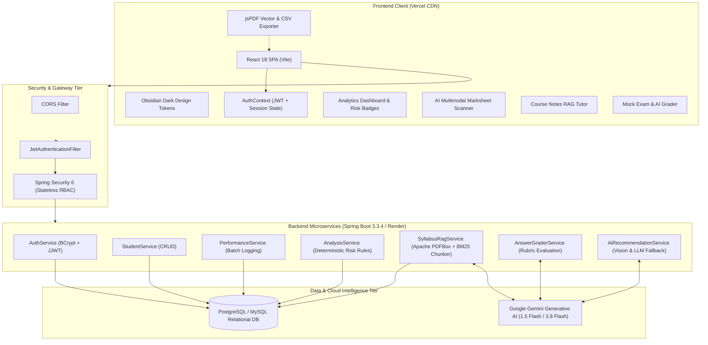

<div align="center">

# 🎓 EduPulse
### AI-Powered Adaptive Learning & Student Performance Intelligence Platform

[](https://reactjs.org/)
[](https://spring.io/projects/spring-boot)
[](https://www.oracle.com/java/)
[](https://ai.google.dev/)
[](https://github.com/rajath1102/Edupulse)
[](https://frontend-rajath7.vercel.app)
[](https://edupulse-1-2ssh.onrender.com)

**An institutional-grade full-stack SaaS platform combining predictive academic risk modeling, multimodal AI marksheet scanning, syllabus-grounded retrieval (RAG), and automated exam answer grading.**

[Explore Live Demo](https://frontend-rajath7.vercel.app) • [API Health Status](https://edupulse-1-2ssh.onrender.com/health) • [Report Issue](https://github.com/rajath1102/Edupulse/issues)

</div>

---

## 📌 Executive Summary

Traditional higher education systems detect student academic failure **retrospectively**—weeks after semester examinations are published when remediation is too late. Furthermore, faculty spend dozens of hours manually entering handwritten marks, while students lack personalized exam preparation grounded in their university's exact syllabus.

**EduPulse** solves this by establishing a proactive, continuous intelligence pipeline:
1. **Predictive Academic Risk Engine**: Real-time identification of at-risk students (`LOW`, `MEDIUM`, `HIGH`) through multi-subject scores and attendance thresholds before official university grading deadlines.
2. **Multimodal AI Exam Scanner**: Uses Google Gemini Vision OCR to scan physical exam marksheet photos, automatically parse handwritten/printed student scores, and commit batch records in 1 click.
3. **Course Notes & Syllabus RAG Tutor**: Grounded question-answering with Apache PDFBox text extraction and semantic chunking to explain concepts citing specific units.
4. **Interactive Exam Simulator & AI Grader**: Real-time evaluation of student answers against university rubrics with score breakdown, missing points, and revision tips.
5. **Last-Night Revision Cheat Sheet**: 1-click synthesis of high-yield 2-mark definitions, theorems, formulas, and common exam pitfalls.

---

## 🌟 Key Highlights & Live URLs

- 🌐 **Production Frontend**: [https://frontend-rajath7.vercel.app](https://frontend-rajath7.vercel.app)
- ⚙️ **Production Backend API**: [https://edupulse-1-2ssh.onrender.com](https://edupulse-1-2ssh.onrender.com)
- 🩺 **Health Check**: [https://edupulse-1-2ssh.onrender.com/health](https://edupulse-1-2ssh.onrender.com/health)

### 🔑 1-Click Interactive Demo Accounts

| Role | Username | Password | Key Permissions |
| :--- | :--- | :--- | :--- |
| **Faculty / Professor** | `teacher` | `teacher123` | Student management, batch marks entry, OCR marksheet scanner, cohort analytics |
| **Administrator** | `admin` | `admin123` | Platform settings, database controls, role management |
| **Student** | `student` | `student123` | Personal profile, EduBot AI tutor, mock exams, syllabus RAG tutor |

---

## 🏛️ System Architecture



---

## 🚀 Core Features & Workflows

### 1. 📊 Predictive Academic Risk & Diagnostics Engine
- **Deterministic Evaluation Matrix**:
  - `Average Marks >= 75%` $\rightarrow$ **LOW Risk** (Strong academic momentum).
  - `50% <= Average Marks < 75%` $\rightarrow$ **MEDIUM Risk** (Average standing, weak subject vulnerability).
  - `Average Marks < 50%` $\rightarrow$ **HIGH Risk** (Immediate academic intervention triggered).
- **Weak Subject Detection**: Identifies any subject where a student scores below 50.0% and flags it for targeted study planning.
- **Attendance Correlation**: Computes running attendance percentages alongside grades to identify students violating university minimum attendance norms (e.g. AICTE 75% rule).

### 2. 📷 AI Exam Score Sheet Scanner (Multimodal OCR)
- Eliminates manual marksheet data entry.
- Faculty upload a photo or scan of a score sheet (JPEG, PNG, or WebP).
- **Gemini Vision Pipeline**: Parses handwritten student names, subject titles, scores, and attendance rates into structured JSON.
- **Entity Resolution**: Fuzzy matches scanned student names against the registered student roster.
- **Human-in-the-Loop Review**: Faculty can edit scores, reassign matched students, or remove rows before committing to the database via batch transaction.

### 3. 📚 Course Notes & Syllabus "RAG" Tutor
- **Retrieval-Augmented Generation (RAG)** grounded strictly in university course material.
- **PDF Ingestion Engine**: Powered by **Apache PDFBox 3.0.3** to extract structured text from multi-page PDFs or lecture slides.
- **Chunk Indexing**: Documents are split into semantic units with metadata tracking (Unit, Chapter, Section).
- **Grounded Verification**: EduBot cites the exact Unit and Chapter from which answers are derived, eliminating AI hallucinations.

### 4. 🎯 Interactive Exam Simulator & AI Grader
- Generates standard university question papers (2-mark short questions and 10-mark long questions) with marking schemes.
- Students type answers directly into the answer box or upload responses.
- **AI Rubric Evaluator**:
  - Compares student answers against textbook scoring rubrics.
  - Returns numeric marks awarded, percentage, and qualitative performance band (`EXCELLENT`, `GOOD`, `NEEDS_IMPROVEMENT`).
  - Highlights specific strengths, omitted derivations or diagrams, and model answer improvement tips.

### 5. ⚡ Last-Night Revision Cheat Sheet Generator
- 1-Click synthesis designed for high-stress pre-exam review.
- Generates:
  - **Must-Know 2-Mark Definitions**: Formulated exactly as required for maximum marks.
  - **Key Formulas & Theorems**: Condensed mathematical and algorithmic formulas.
  - **10-Mark Architectural Figures**: Bulleted guidelines for diagrams and schematics.
  - **Exam Hall Traps**: Common misconceptions that lead to lost marks.

### 6. 📄 Official PDF & CSV Academic Reports
- **Vector PDF Export**: Built using `jsPDF` and `jspdf-autotable`. Produces formal A4 academic reports featuring institution branding, student metadata, health diagnostics summary, subject marks table, and AI remediation plan.
- **RFC-4180 CSV Export**: Generates clean CSV files with UTF-8 BOM (`\uFEFF`) for direct compatibility with Microsoft Excel, Google Sheets, and institutional ERP systems.

### 7. 🔒 Student Data Privacy & Role-Based Access Control
- Custom Spring Security filters enforce strict boundaries:
  - Students can view **only** their own performance records and analytics.
  - Attempts to access other students' records by manipulating URL IDs return **HTTP 403 Forbidden**.
  - Student creation, score logging, and marks deletion are restricted strictly to `ROLE_TEACHER` and `ROLE_ADMIN`.

---

## 🛠️ Technology Stack Breakdown

| Domain | Technology | Version | Description |
| :--- | :--- | :--- | :--- |
| **Backend Framework** | Spring Boot | 3.3.4 | Microservice REST framework with inversion of control |
| **Language Runtime** | Java OpenJDK | 17 LTS | Modern LTS Java runtime with strong typing |
| **Security** | Spring Security | 6.x | Stateless JWT filter chain with BCrypt password hashing |
| **Token Architecture** | JJWT | 0.12.6 | HMAC-SHA256 signed JSON Web Tokens |
| **ORM & Persistence** | Spring Data JPA / Hibernate | 6.x | Entity mappings, repository queries, and schema generation |
| **Database** | PostgreSQL / MySQL | 8.x / 16.x | High-performance relational database with HikariCP |
| **Document Processing** | Apache PDFBox | 3.0.3 | Native PDF text and page extraction |
| **AI Integration** | Google Gemini Generative AI | 1.5 Flash / 3.8 Flash | Multimodal vision & generative text models |
| **Frontend Framework** | React | 18.2 | Component-driven Single Page Application |
| **Build & Bundler** | Vite | 5.x | Ultra-fast HMR and optimized production build tool |
| **Client-Side Export** | jsPDF + autoTable | 2.5.1 / 3.8.2 | Vector PDF report renderer |
| **UI Design System** | Custom Obsidian CSS | CSS3 | High-contrast dark mode design tokens |
| **Frontend Hosting** | Vercel | Global CDN | Automatic continuous deployments from Git |
| **Backend Hosting** | Render | Docker Container | Cloud container service with automated health monitoring |

---

## 📡 REST API Reference

All protected endpoints require the HTTP header:  
`Authorization: Bearer <JWT_TOKEN>`

### Authentication & Profiles
| Method | Endpoint | Access | Description |
| :--- | :--- | :--- | :--- |
| `POST` | `/api/auth/register` | Public | Register a new user account |
| `POST` | `/api/auth/login` | Public | Authenticate credentials and receive JWT |
| `GET` | `/api/auth/me` | Authenticated | Retrieve currently authenticated user profile |

### Student Management
| Method | Endpoint | Access | Description |
| :--- | :--- | :--- | :--- |
| `GET` | `/api/students` | All Roles | Retrieve all registered student profiles |
| `GET` | `/api/students/{id}` | All Roles | Retrieve single student profile by ID |
| `POST` | `/api/students` | Teacher / Admin | Register a new student profile |
| `PUT` | `/api/students/{id}` | Teacher / Admin | Update student profile information |
| `DELETE` | `/api/students/{id}` | Teacher / Admin | Delete student record and cascading marks |

### Performance & Marks Logging
| Method | Endpoint | Access | Description |
| :--- | :--- | :--- | :--- |
| `GET` | `/api/performance/student/{id}` | Owner / Faculty | Get all subject performance records for student |
| `POST` | `/api/performance` | Teacher / Admin | Log a single performance entry |
| `POST` | `/api/performance/batch` | Teacher / Admin | Batch commit multiple student performance records |

### Analytics & AI Intelligence
| Method | Endpoint | Access | Description |
| :--- | :--- | :--- | :--- |
| `GET` | `/api/analysis/student/{id}` | Owner / Faculty | Compute average marks, attendance, and risk level |
| `POST` | `/api/ai/recommendation/{id}` | All Roles | Generate personalized adaptive study recovery plan |
| `POST` | `/api/ai/chat` | All Roles | EduBot real-time academic conceptual explanations |
| `POST` | `/api/ai/scan-marks` | Teacher / Admin | Gemini Vision OCR extraction on marksheet photo |
| `POST` | `/api/ai/syllabus/upload` | All Roles | Upload & index syllabus document (PDF / TXT) |
| `GET` | `/api/ai/syllabus` | All Roles | List all indexed syllabus documents |
| `POST` | `/api/ai/syllabus/query` | All Roles | Query indexed course notes with grounded citations |
| `POST` | `/api/ai/mock-exam/generate`| All Roles | Generate university mock paper with answer keys |
| `POST` | `/api/ai/grade-answer` | All Roles | Interactive AI answer evaluation against rubric |
| `POST` | `/api/ai/cheat-sheet` | All Roles | Generate 15-minute Last-Night Revision Cheat Sheet |
| `GET` | `/health` | Public | Cloud container health check |

---

## 💻 Local Development Setup

### Prerequisites
- **Java Development Kit (JDK)**: Version 17 or higher
- **Node.js**: Version 18 or higher & npm
- **Database**: MySQL 8.x or PostgreSQL 14+
- **Google Gemini API Key**: [Get a free API key here](https://aistudio.google.com/)

---

### Step 1: Clone the Repository
```bash
git clone https://github.com/rajath1102/Edupulse.git
cd Edupulse
```

---

### Step 2: Configure Backend (`application.properties`)
Create or edit `src/main/resources/application.properties`:
```properties
# Server
server.port=8080

# Database Configuration (MySQL Example)
spring.datasource.url=jdbc:mysql://localhost:3306/edupulse?createDatabaseIfNotExist=true&useSSL=false
spring.datasource.username=root
spring.datasource.password=your_db_password
spring.datasource.driver-class-name=com.mysql.cj.jdbc.Driver
spring.jpa.hibernate.ddl-auto=update

# Google Gemini AI Configuration
gemini.api.key=YOUR_GEMINI_API_KEY_HERE
gemini.api.model=gemini-1.5-flash

# JWT Security
jwt.secret=404E635266556A586E3272357538782F413F4428472B4B6250645367566B5970
jwt.expiration-ms=86400000
```

---

### Step 3: Run the Backend
```bash
# Using Maven wrapper
./mvnw clean spring-boot:run

# Or on Windows PowerShell:
.\mvnw.cmd clean spring-boot:run
```
Backend will start on `http://localhost:8080`.

---

### Step 4: Run the Frontend
```bash
cd frontend

# Install dependencies
npm install

# Configure local backend URL
# Create .env.local:
echo "VITE_API_URL=http://localhost:8080" > .env.local

# Start Vite dev server
npm run dev
```
Frontend will start on `http://localhost:5173`.

---

## 🧪 Testing & Verification

The backend includes a comprehensive integration test suite validating authentication, JWT verification, role-based authorization, and student data privacy.

```bash
# Execute integration test suite
./mvnw test
```

Key integration tests covered in [`SecurityAndAuthIntegrationTests.java`](src/test/java/com/edupulse/SecurityAndAuthIntegrationTests.java):
- `testUnauthenticatedAccessReturnsUnauthorized`: Validates HTTP 401 on protected routes without tokens.
- `testDemoAdminLoginAndSuccess`: Validates JWT issuance and admin access.
- `testStudentRegistrationAndRoleRestrictions`: Confirms students cannot create student entities (HTTP 403).
- `testStudentPrivacyAccessRestrictions`: Validates that a student cannot view another student's marks or diagnostics.
- `testEduBotChatEndpointSuccess`: Validates AI response generation with Gemini fallback.

---

## 🌐 Production Deployment Architecture

- **Frontend (Vercel CDN)**:
  - Deployed on Vercel's global edge network.
  - Automatically builds from `origin/main` on push.
  - Configured with `fetchWithTimeout` failover: if backend experiences a cold start, cached metrics render instantly within 3.5s.
- **Backend (Render Cloud Container)**:
  - Packaged via multi-stage `Dockerfile` with OpenJDK 17.
  - Memory-optimized JVM flags: `-XX:+UseSerialGC -Xms64m -Xmx350m`.
  - Automatic scheduled keep-alive workflow via GitHub Actions ([`.github/workflows/keep_alive.yml`](.github/workflows/keep_alive.yml)) pings `/api/students` every 12 minutes to keep the container awake.

---

## 📄 License & Academic Attribution

This project is developed as an academic capstone and educational platform.  
Created by **Rajath S Kumbari**.

Distributed under the **MIT License**. Free for educational, academic, and non-commercial development.
